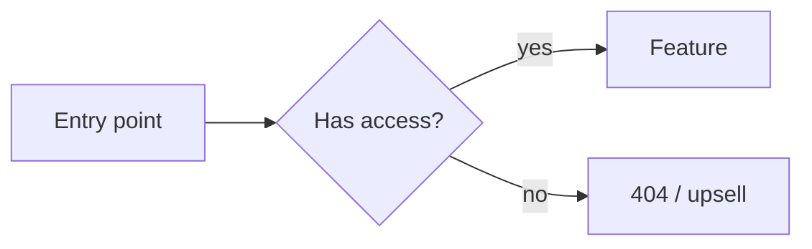
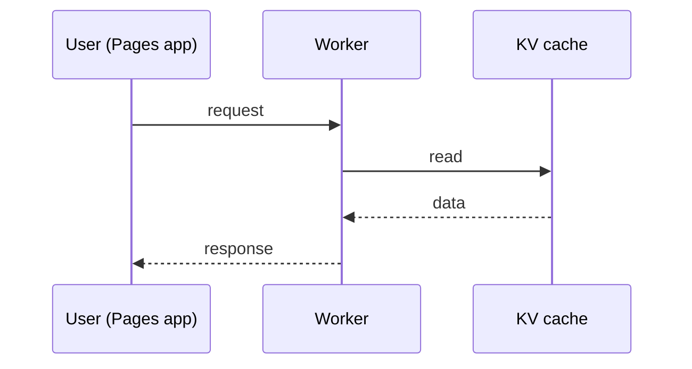
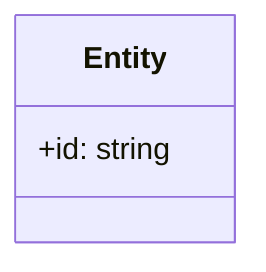

# PRD: <Feature name>

**Status:** Draft · **Owner:** <name> · **Updated:** <YYYY-MM-DD> · **Builder:** <name or TBD>

<!-- Template note, do not copy: keep it skimmable. say each fact once in the section that owns it, link instead of repeating, and delete empty sections. -->

## Summary

**Problem.** <1–2 sentences: who hurts, how, and how we know.>

**Solution.** <1–2 sentences: what we build and how it removes that pain.>

**Success looks like.** <Required. 1 measurable outcome: PostHog metric, baseline, target, and timeframe.>

## Users & context

- **Primary user:** <persona / access flag, e.g. `meteorologistAccess` users>
- **Trigger:** <when/why they reach for this>
- **Today's workaround:** <what they do now>

## Scope

### In scope

- <assertion>

### Non-goals

- <explicitly excluded thing, and why>

## Requirements

Each requirement is a 1–2 sentence assertion with a stable ID. Gherkin follows where behaviour matters. Every requirement ends with a `Source:` line citing a repo file (with lines), doc, GitHub link, or connector evidence. If none exists, write `Source: user decision (no supporting evidence found)`.

### R1 — <short name>

<Assertion: "The system shows X to Y when Z.">

Source: <`path/to/file.ts:10-24` · PostHog insight _X_ on dashboard _Y_ · link>

```gherkin
Scenario: <name>
  Given <state>
  When <action>
  Then <observable outcome>
```

### R2 — <short name>

<Assertion.>

Source: <citation>

## Edge cases & failure modes

| Case                                       | Expected behaviour |
| ------------------------------------------ | ------------------ |
| <empty / offline / no access / stale data> | <assertion>        |

## Design

Include at least one diagram. Keep only the diagrams below that show something the text does not; delete the rest.

### User flow



### System interaction



### Data model (if any)



## Access, analytics & infrastructure

- **Access:** <which kernel flag gates it; enforced server-side via `authenticate*`; or "public">
- **Analytics:** <PostHog events + properties>
- **Infra:** <Pages / Worker / KV / D1 changes>

## Rollout

- **Feature flag:** <PostHog flag key, or "none" with reason>
- **Stages:** <e.g. admins → meteorologists → everyone, with the gate to advance>
- **Kill switch:** <how to turn it off, and what users see when it is off>

## Decisions

| Topic | Decision | Rationale |
| ----- | -------- | --------- |

## Alternatives considered

| Alternative | Why rejected |
| ----------- | ------------ |

## Open questions

- [ ] <anything the user explicitly deferred; empty if none>

## Glossary

| Term | Definition |
| ---- | ---------- |

## Appendix

### Parked problems

Problems raised during brainstorming that are out of scope for this PRD.

- <problem> — <why parked>

### References

- <links to code, docs, prior PRDs, external reading>
